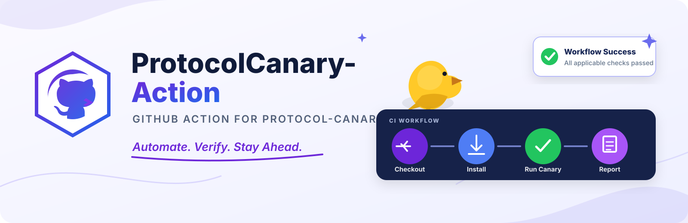

# ProtocolCanary-Action



[](https://github.com/StellarCanary/ProtocolCanary-Action/actions/workflows/ci.yml) [](https://github.com/StellarCanary/ProtocolCanary-Action/releases) [](LICENSE)

The official GitHub Actions integration for [Stellar Protocol
Canary](https://github.com/StellarCanary/Protocol-Canary). It makes Stellar
protocol compatibility testing a normal part of GitHub CI.

[Documentation](https://stellarcanary.github.io/Protocol-Canary/) | [Protocol-Canary](https://github.com/StellarCanary/Protocol-Canary) | [Fixtures](https://github.com/StellarCanary/ProtocolCanary-Fixtures)

## Contents

- [What it does](#what-it-does)
- [Quick start](#quick-start)
- [Example workflow](#example-workflow)
- [Inputs](#inputs)
- [Outputs](#outputs)
- [How failures appear](#how-failures-appear)
- [Artifacts](#artifacts)
- [Installation & integrity](#installation--integrity)
- [Versioning](#versioning)
- [Limitations](#limitations)
- [Security](#security)
- [Code of Conduct](#code-of-conduct)
- [Maintainers & Community](#maintainers--community)
- [Development](#development)
- [License](#license)

## What it does

This Action is a thin wrapper around the real `stellar-canary` CLI. It does
not know what CAP-83 or CAP-85 mean, does not reimplement XDR/RPC/Soroban
testing, and never reinterprets a compatibility result the CLI didn't
report. It:

1. installs the requested `Protocol-Canary` version (from source, pinned —
   see [Installation & integrity](#installation--integrity));
2. runs `stellar-canary check --format json` with your inputs;
3. publishes a GitHub job summary and (optionally) annotations from that
   JSON;
4. optionally uploads the JSON report as a workflow artifact;
5. passes or fails the job according to Canary's own exit code — never a
   result the Action computed itself.

All compatibility logic lives in
[`StellarCanary/Protocol-Canary`](https://github.com/StellarCanary/Protocol-Canary).
Canonical fixtures live in
[`StellarCanary/ProtocolCanary-Fixtures`](https://github.com/StellarCanary/ProtocolCanary-Fixtures).

## Prerequisites

Before following the quick-start example, make sure the runner meets the
requirements below:

- A Rust/Cargo toolchain is available. This Action installs
  `Protocol-Canary` from source with `cargo install --git`, so a
  self-hosted or non-Ubuntu runner must install Rust first; GitHub-hosted
  Ubuntu runners include Cargo by default.
- The `version` input matches a real release tag in
  `StellarCanary/Protocol-Canary`. It is pinned to a specific upstream
  release and never tracks `main`.

See [Installation & integrity](#installation--integrity) and the `version`
entry in [Inputs](#inputs) for the full explanation and setup guidance.

## Quick start

```yaml
- uses: actions/checkout@v4
- uses: StellarCanary/ProtocolCanary-Action@v1
  with:
    protocol: "28"
```

This snippet is not runnable on its own: `fixtures-dir` defaults to
`fixtures`, relative to the job's working directory, and a freshly
checked-out project normally has no `fixtures/` directory — so the step
now fails fast with a clear `fixtures-dir` error, before the engine is
installed, instead of installing Canary just to check nothing. Either
point `fixtures-dir` at your own fixtures or check out a fixtures pack
first, as [`examples/protocol-28.yml`](examples/protocol-28.yml) does.

See [`examples/`](examples/) for the complete, runnable workflows —
including that Protocol 28 one, which checks out the real
`ProtocolCanary-Fixtures` pack and sets `fixtures-dir` to match — and for
one that runs on a self-hosted runner
([`examples/self-hosted.yml`](examples/self-hosted.yml)).

## Checking many projects in parallel (matrix examples)

Monorepos that contain several contracts or services usually want to run a
Canary check for each of them, in parallel, and then see one combined result.
Two maintained example workflows cover that pattern
([`.github/workflows/examples/`](.github/workflows/examples/)):

- [`matrix-check.yml`](.github/workflows/examples/matrix-check.yml) runs the
  Action once per matrix target. Each leg resolves its own `project-root`
  (fixtures and config are derived from it, so legs never touch the same
  paths), disables the Action's fixed-name report upload, and uploads the
  JSON report itself under a target-unique artifact name
  (`report-${{ matrix.target }}`) so parallel legs can never overwrite each
  other's results.
- [`matrix-aggregation.yml`](.github/workflows/examples/matrix-aggregation.yml)
  adds an `aggregate` job that runs with `if: always()`, downloads every
  `report-*` artifact without merging them, and renders one consolidated
  Markdown table into the GitHub job summary. A target whose report never
  arrived is highlighted as **missing** in the table instead of crashing the
  aggregation, so a partially-failed matrix still produces a single clear
  overview.

Both files live under `.github/workflows/examples/`, which GitHub does not
execute — copy them into your own `.github/workflows/` and replace the
example matrix entries with your projects' paths.

## Example workflow

```yaml
name: Stellar Compatibility

on:
  pull_request:
  push:
    branches: [main]

permissions:
  contents: read

jobs:
  compatibility:
    runs-on: ubuntu-latest
    steps:
      - uses: actions/checkout@v4
      - uses: StellarCanary/ProtocolCanary-Action@v1
        with:
          protocol: "28"
```

## Inputs

| Input | Description | Default |
|---|---|---|
| `protocol` | Target Stellar protocol version (`--protocol`), a whole number from 1 to 4294967295 (the engine rejects 0). | (from `.stellar-canary.toml`, or 28) |
| `config` | Path to `.stellar-canary.toml` (`--config`). Fails clearly if the given path does not exist, or is not a regular file (e.g. a directory). | (CLI default lookup) |
| `working-directory` | Directory to treat as the project root, forwarded as `--project-root` so a monorepo can check one subdirectory or workspace member. Relative paths are resolved against the workspace; a path that does not exist or is not a directory fails the run before Canary is invoked. The default (`.`, the workspace itself) is validated but not forwarded. Requires a Protocol-Canary release whose CLI supports `--project-root`; older releases reject the argument. | `.` |
| `network` | Network for live RPC/Soroban checks (`--network`). | `testnet` (CLI default) |
| `network-passphrase` | Expected network identity for RPC verification (`--network-passphrase`). Preserved exactly, must be non-empty and contain no control characters. An explicit value overrides the passphrase associated with `network`. Forwarded with Protocol-Canary `0.3.0` or newer; older engines ignore it with a warning. | (none) |
| `rpc-url` | Stellar RPC endpoint (`--rpc-url`). Must be `https://`, or `http://localhost`/`127.0.0.1` for local development. | (none) |
| `rpc-max-retries` | Maximum retries after a failed RPC request (`--rpc-max-retries`). `0` disables retries; accepted range is 0 to 4294967295. Forwarded with Protocol-Canary `0.3.0` or newer; older engines ignore it with a warning. | Engine default (3) |
| `rpc-retry-delay-ms` | Linear-backoff base delay between RPC retries (`--rpc-retry-delay-ms`), in milliseconds; accepted range is 0 to 9007199254740991. Forwarded with Protocol-Canary `0.3.0` or newer; older engines ignore it with a warning. | Engine default (500) |
| `fixtures-dir` | Path to a directory of fixtures, e.g. a checkout of `ProtocolCanary-Fixtures` (`--fixtures-dir`). Resolved against the job's working directory and validated **before** the engine version is resolved or installed: it must name an existing directory. A missing directory fails the run immediately with an error naming `fixtures-dir` and the resolved absolute path; with `allow-empty: true` a missing directory only warns (naming the input and path) and the run continues; a path that exists but is not a directory (e.g. a regular file) is always rejected, even with `allow-empty: true`. | `fixtures` |
| `fixture` | Run only the fixture with this exact id (`--fixture=<id>`) — the usual way to reproduce one failing check in CI. Empty/whitespace means unset; must not contain control characters (no other restrictions — the value is passed as one `--flag=value` argument, so an id beginning with `-` is safe). **Requires an engine release whose `check` accepts `--fixture`:** while no released Protocol-Canary supports it (today's state), setting this fails the run *before* install/run, naming the input and resolved `version` — the Action never silently runs the whole suite instead. | (none) |
| `surface` | Run only fixtures of this surface (`--surface=`): exactly `xdr`, `rpc`, or `soroban` (lower case, as the engine accepts); anything else fails with an input error naming the accepted values. Same pre-run engine gate as `fixture`: rather than checking every surface, the Action fails before installing or running. | (none) |
| `cache-dir` | Directory for cached fixture results (`--cache-dir=`), forwarded to the engine **unchanged**: a relative path is resolved by the *engine* against `--project-root` when one is given — not against `GITHUB_WORKSPACE`, `fixtures-dir`, or a future `working-directory` input (#348). Missing directories are created by the engine; a path that is an existing file is rejected by the engine; it may be combined with the engine's cache-disabling flag (the engine accepts both, though this Action does not yet expose `--no-cache` as an input). Empty/whitespace means unset; control characters are rejected. Same pre-run engine gate as `fixture`: an unsupported engine fails the run rather than caching results somewhere you did not ask for. | (none) |
| `version` | `Protocol-Canary` version to install, without a leading `v`. Pinned — never tracks `main`. | `0.2.0` |
| `upload-report` | Upload the JSON report as a workflow artifact. | `true` |
| `annotations` | Emit GitHub annotations for failures/warnings/errors. | `true` |
| `diagnostics` | Opt in to a best-effort redacted diagnostics log bundle when Canary cannot produce a usable report. Strictly opt-in: the artifact is downloadable by anyone who can read the repository, and the process environment is never included. | `false` |
| `allow-empty` | Let a run that executes no checks pass (`--allow-empty`). Only meaningful with `version: 0.2.0` or newer, which fail such a run by default; older versions already pass it, so the flag is not forwarded to them. | `false` |
| `fail-on-warning` | Treat Protocol Canary warnings as failures (`--fail-on-warning`). Currently ignored with a warning until a Protocol-Canary release supports the flag. | `false` |
| `offline` | Skip network-dependent fixtures (`--offline`). Currently ignored with a warning until a Protocol-Canary release supports the flag. | `false` |
| `junit-report` | Render the JSON report to JUnit XML using the engine's own `stellar-canary report <file> --format junit` command and expose the file as the `junit-report-path` output. Written next to the JSON report and included in the artifact when `upload-report` is `true`. **Minimum engine version:** the release that adds `report --format junit` (Protocol-Canary #434; not in `0.2.0`) — with an older engine nothing is produced and a warning is logged. Any failure (unsupported engine, non-zero exit, empty output, missing report file) is a warning only: it never changes `status` and never fails the job. | `false` |
| `timeout-minutes` | Maximum time to let Canary run before it is terminated. Must be a whole number from 1 to 35791 minutes: larger values would overflow Node's 32-bit timer (2,147,483,647 ms) and fire immediately, so they are rejected up front. Also bounds the `cargo install` step (floored at one minute) — see [Timeouts](#timeouts). | `15` |
| `github-token` | Optional token for read-only requests to `api.github.com` for version resolution and checksum discovery. Set it to `${{ github.token }}` to authenticate (requires `contents: read`); otherwise requests are unauthenticated unless `GITHUB_TOKEN` is present in the environment. Pass an empty string (`""`) to disable authentication. | (none) |
| `fixtures-pack-version` | Release tag of the fixture pack to run against, e.g. `v1.2.0` (leading `v` optional); unpinned values like `latest` are rejected. **Accepted and validated, but not forwarded to Canary** — it has no fixture-pack flag, so the run still reads whatever `fixtures-dir` points at. Pin the pack by checking out its tag into `fixtures-dir`. | (none) |
| `fixtures-pack-protocol` | Protocol version the pack is pinned to, as a positive integer (`0` is rejected, as with `protocol`). **Accepted and validated, but not forwarded to Canary** — see above. The protocol a run checks is `protocol`. | (none) |
| `baseline-report` | Path to a previous Protocol Canary JSON report. The file must exist and be a schemaVersion 1 report for the same target protocol as this run. **Validated only**: the engine's `diff` command is not released yet (#335), so no regression verdict is produced. A missing, malformed, or protocol-incompatible baseline fails the run with an actionable annotation. | (none) |
| `generate-receipt` | Generate a machine-readable Execution Receipt (provenance: engine version, engine build commit, fixture-pack digest, target protocol, observed protocol, timestamp) and upload it as the `stellar-canary-receipt-<run-id>` artifact; `receipt-path` carries the file location. | `false` |
| `strict-integrity` | Fail-closed integrity policy. When `true`, the run aborts whenever binary integrity cannot be proven (no published checksum manifest, no entry for this platform, or a checksum lookup that could not be completed); when `false` it degrades to commit/tag pinning with a debug note. A checksum mismatch aborts the run in either mode. A checksum verifies data integrity, not the release author's identity. See [`docs/security-model.md`](docs/security-model.md). | `false` |
| `pr-comment` | Opt in to a bounded pull request summary comment. Requires `pull-requests: write` on same-repository `pull_request` workflows; fork PRs and other events are skipped, and permission failures are warnings, not failed checks. | `false` |

There is deliberately no `format` input: the Action always requests
`--format json` from the CLI (the only way it can build the summary and
annotations), and never invokes Canary twice to get a second format.

## Outputs

All values are strings, as GitHub Actions outputs always are. The counts
(`passed`, `warnings`, `failures`, `errors`, `total`, `skipped`, `replayed-count`) are decimal-string integers
(rendered with `String(n)`), and `status` is one of the five fixed
literals below.

| Output | Description | Example |
|---|---|---|
| `status` | `pass`, `warning`, `fail`, `error`, or `execution-failed` (the Action's own value when Canary could not produce a report at all — see below). | `"fail"` |
| `passed` | Number of checks that passed. | `"12"` |
| `warnings` | Number of checks that produced a warning. | `"1"` |
| `failures` | Number of checks that failed a compatibility assertion. | `"2"` |
| `errors` | Number of checks that could not complete due to an execution error. | `"0"` |
| `total` | Total number of checks in the report counts. Explicitly set to `0` on an execution failure, like the other counts. | `"15"` |
| `skipped` | Number of checks skipped. Explicitly set to `0` on an execution failure, like the other counts. | `"0"` |
| `replayed-count` | Number of checks whose results were replayed from Protocol Canary's result cache instead of being executed in this run. Engines whose reports predate the cache always report `0`. Explicitly set to `0` on an execution failure, like the other counts. | `"3"` |
| `engine-version` | Protocol Canary engine version that produced the result, read from the installed binary. On an execution failure, set to the resolved version if installation succeeded, or an empty string if installation failed. | `"0.1.1"` |
| `observed-protocol` | Stellar protocol version reported by the network during live checks (`network.observedProtocol`), or an empty string when the report has no network object. Explicitly set to an empty string on an execution failure. | `"28"` |
| `pack-protocol` | Protocol version of the resolved fixture pack, from `fixturePack.protocol` in the report or the `fixtures-pack-protocol` input. Empty when no pack identity is recorded. | `"28"` |
| `pack-version` | Release tag/version of the resolved fixture pack, from `fixturePack.version`/`tag` or the `fixtures-pack-version` input. Empty when no pack identity is recorded. | `"v1.2.0"` |
| `pack-digest` | Canonical content digest of the resolved fixture pack, formatted as `sha256:<64 lowercase hex>`, when the report records one. Empty when no digest is recorded or the recorded value is malformed; the Action never fabricates a digest. | `"sha256:…"` |
| `report` | Absolute path to the JSON report file this invocation wrote. The file is uniquely named per invocation (see below), so it is never shared with another Action step. Only set when Canary produced output to parse and the report file was written successfully; empty/unset on report write failure or execution failure (`status` `execution-failed`). | `/home/runner/work/_temp/stellar-canary-report-canary-check-4b9c1d2e3f4a5b6c.json` |
| `receipt-path` | Absolute path to the invocation-specific Execution Receipt JSON (each invocation writes a distinct file under `RUNNER_TEMP`, so subsequent steps cannot overwrite it). Set only when `generate-receipt` is `true` and Canary produced a parseable report; unset otherwise, including on an execution failure. | `/home/runner/work/_temp/stellar-canary-receipt-<unique>.json` |
| `junit-report-path` | Absolute path to the generated JUnit XML file. Only set when `junit-report` is `true` **and** the engine's render succeeded; unset otherwise (input disabled, engine without the command, failed/empty render) and on an execution failure. A failed render is always a warning, never a status change. | `/home/runner/work/_temp/stellar-canary-report.junit.xml` |
| `coverage-state` | How completely the fixture set was exercised: `full` (every discovered fixture ran, none skipped), `partial` (something ran, but fixtures were skipped), or `none` (nothing ran — an empty run or an execution failure). | `"full"` |

`coverage-state` is meant for a job that gates a promotion on *coverage*
rather than on the verdict alone — a `pass` with `coverage-state: partial`
means Canary only exercised part of the fixture set:

```yaml
- uses: StellarCanary/ProtocolCanary-Action@v1
  id: canary
- name: Require full fixture coverage before promoting
  if: steps.canary.outputs.coverage-state != 'full'
  run: echo "Coverage was ${{ steps.canary.outputs.coverage-state }}, not full — see the JSON report artifact."
```

A concrete consumer, using the outputs to gate a follow-up step:

```yaml
- uses: StellarCanary/ProtocolCanary-Action@v1
  id: canary
  with:
    protocol: "28"
- name: React to the result
  if: steps.canary.outputs.status == 'fail'
  run: echo "${{ steps.canary.outputs.failures }} check(s) failed"
```

Every Action invocation writes its report to its own uniquely named JSON
file, directly inside the runner's temporary directory (`RUNNER_TEMP`,
falling back to the system temp directory). The filename is
`stellar-canary-report-<step>-<random>.json`, where `<step>` is the
current step's `GITHUB_ACTION` identifier sanitized to ASCII letters,
digits, `-`, and `_`, and `<random>` is a short cryptographically random
suffix. Multiple Action steps in the same job therefore never overwrite
each other's reports, and the `report` output always contains the
absolute path of the file *that* invocation wrote — so a later step can
safely read or upload an earlier step's report:

```yaml
- uses: StellarCanary/ProtocolCanary-Action@v1
  id: canary
  with:
    protocol: "28"
- name: Read the report from a later step
  run: jq .status "${{ steps.canary.outputs.report }}"
```

> **Note:** When `status` is `execution-failed`, the numeric outputs (`passed`, `warnings`, `failures`, `errors`, `total`, `skipped`, `replayed-count`) are all explicitly set to the string `"0"`, `observed-protocol`, `pack-protocol`, `pack-version`, and `pack-digest` are set to empty strings `""`, and `engine-version` is set to the resolved version if installation succeeded or `""` if installation failed. They do **not** represent a real count of zero compatibility issues — they indicate that Canary never produced a report at all. Always check `status` first before relying on the counts.
> `coverage-state` is set on that path too, always as `none`, so a consumer never has to distinguish "unset" from "no coverage".

## How failures appear

The Action distinguishes two different kinds of "red":

- **A compatibility failure** — Canary ran successfully and found a real
  incompatibility. `status` is `fail` (or `warning`/`error`); the job
  summary shows a per-surface table and the specific failing test IDs;
  annotations point at each one.
- **An execution failure** — Canary could not be installed, could not run,
  timed out, or produced output that could not be parsed as a report.
  `status` is `execution-failed`; the summary says "Protocol Canary could
  not be executed" with the actual diagnostic, never a fabricated
  compatibility message.

A separate failure — the job summary itself failing to publish — is
reported as "Failed to publish Canary summary," distinct from both of the
above.

### Annotation limits

GitHub enforces a platform-level cap on how many annotations are surfaced
in the UI per step and per workflow run, and silently drops any beyond
that cap. This Action emits one annotation per failing, erroring, or
warning result and does not batch or truncate, so a very large fixture set
— or a run with many simultaneous failures — can produce more annotations
than GitHub will display.

That cap applies only to annotations. The job summary and the JSON report
list every result regardless, so treat them, not the annotations, as the
complete record of what Canary found. See GitHub's
[workflow command documentation](https://docs.github.com/en/actions/reference/workflows-and-actions/workflow-commands)
for the platform's exact behavior.
### What the job summary looks like

The summary is rendered by `renderSummaryMarkdown` in
[`src/summary.ts`](src/summary.ts). A passing run over three surfaces, with a
network configured and one fixture skipped:

```markdown
## Stellar Protocol Canary

Protocol: 28
Project: my-soroban-contracts (soroban)
Network: testnet — observed protocol 28
Canary version: 0.1.1

| Surface | Result |
|---|---|
| XDR | ✅ PASS (2/2) |
| RPC | ✅ PASS (1/1) |
| Soroban | ✅ PASS (1/1) |

### Result

✅ **PASS**

4/4 applicable checks passed.

<details><summary>Skipped fixtures</summary>

| Reason code | Fixture | Surface | Reason |
|---|---|---|---|
| `UNSUPPORTED_PROTOCOL` — Unsupported protocol | `p27-xdr-legacy` | xdr | fixture targets protocol 27, this run targets protocol 28 |

</details>
```

And a run with a failing check, a warning, and a check that could not complete:

```markdown
## Stellar Protocol Canary

Protocol: 28
Project: my-soroban-contracts (soroban)
Network: testnet — observed protocol 28
Canary version: 0.1.1

| Surface | Result |
|---|---|
| XDR | ❌ FAIL (1/2) |
| RPC | ⚠️ WARNING (0/1) |
| Soroban | ❌ FAIL (0/1) |

### Result

❌ **NOT READY**

1/4 applicable checks passed.

#### Failures

- `p28-xdr-cap85-002` (xdr) — transaction envelope metadata differs from the expected encoding
  expected discriminant 3, found 2
  at line 1, column 24
- `p28-soroban-invoke-004` (soroban) — simulateInvoke could not reach the configured RPC endpoint
  connect ETIMEDOUT 10.0.0.1:443

#### Warnings

- `p28-rpc-getledgerentries-003` (rpc) — RPC endpoint returned HTTP 429; result may be incomplete
```

When Canary could not be run at all, the summary says so explicitly instead —
`renderExecutionFailureMarkdown`:

````markdown
## Stellar Protocol Canary

### Result

🚫 **ERROR**

Protocol Canary could not be executed.

Reason: Stellar Protocol Canary timed out after 900s and was terminated.

```text
(no diagnostic output)
```
````

More examples — including the surface ordering, the skipped-fixtures block, and
the no-results case — live in
[`tests/unit/summary.test.ts`](tests/unit/summary.test.ts), which renders
these fixtures through the same function.

Annotations from this Action are workflow-level only: no fixture in the
report schema carries a file/line location, so they appear in the
workflow run's Checks output and logs, never inline on a pull request's
file diff the way file-scoped annotations from other tools do. The Action
never fabricates a location.

**GitHub annotation limits:** GitHub Actions caps the number of annotations
rendered per run (10 per step, 50 per job across error+warning combined).
When a run produces more failing results than this limit, GitHub silently
drops annotations past the cap. The job summary table and failure list
generated by this Action **always include every result** from the full JSON
report, regardless of annotation count. If you see fewer annotations than
failures in the summary, this is why.

## Troubleshooting

Every failure is one of the two kinds described above: a real
compatibility result (`status` `fail`/`warning`/`error`) or the Action
failing to run Canary at all (`status` `execution-failed`). The [bug
report template](.github/ISSUE_TEMPLATE/bug_report.md)'s "Which kind of
failure?" checklist asks you to pick between exactly those two before you
file — the table below maps the most common execution-failure messages to
what to do about each.

| Message (step log / job summary) | Meaning | What to do |
|---|---|---|
| ``The `cargo` command was not found on this runner. …`` | This Action prefers a prebuilt Protocol-Canary release binary when one exists for this platform and version and falls back to building from source only when no usable prebuilt asset was found — so this error means neither path is available: no usable prebuilt release (or no checksum manifest for one) and no Rust toolchain. | On a self-hosted or non-Ubuntu runner, install a toolchain first — e.g. a `dtolnay/rust-toolchain` step ahead of this Action; [`examples/self-hosted.yml`](examples/self-hosted.yml) shows a complete workflow. GitHub-hosted Ubuntu runners include one by default; seeing this there usually means an earlier step removed it from `PATH`. |
| ``` `cargo install` exited with code 101 while installing Protocol-Canary … ``` | The source build failed — most often a Rust toolchain too old for Canary's `Cargo.toml`, a corrupted build cache, or a transient network failure while fetching crates. | Re-run the job once to rule out a transient failure. If it persists, update the runner's Rust toolchain. Cargo's own error output appears in the log above this message; `ACTIONS_STEP_DEBUG: true` adds more detail. |
| `Stellar Protocol Canary timed out after Ns and was terminated.` | Canary ran longer than `timeout-minutes` (default 15; it bounds only the Canary process, not the whole job) and was killed. | Raise `timeout-minutes` if your fixture set legitimately needs longer. Otherwise check whether a live-RPC check is hanging on an unreachable `rpc-url`. |
| `` `cargo install` … timed out after Ns and was terminated. `` | The `cargo install` step ran longer than `timeout-minutes` (floored at one minute — see [Timeouts](#timeouts)) and was killed. | Re-run the job; this is usually a stalled network fetch. Raise `timeout-minutes` if a build of this size legitimately needs longer. Cargo's own progress output appears in the log above this message. |
| `Failed to start …: spawn … ENOENT` | The installed Canary binary could not be launched at all. | Typical on a self-hosted runner with an incompatible architecture or libc. Verify the runner can execute binaries built by its own toolchain, then re-run the job to force a fresh install. |
| `Canary produced no output to parse as a JSON report.` / `Canary's output could not be parsed as JSON: …` | Canary exited without emitting a valid JSON report on stdout — killed mid-run, crashed, or a release this Action cannot parse. | Re-run the job. The step log shows the exact command the Action ran; run it locally to see Canary's stderr. Check that `version` is one of the releases in the [supported versions table](#supported-canary-versions) — older releases' reports predate the `counts` field this Action accepts. |
| `Unsupported report schemaVersion N (this Action supports schemaVersion 1).` | The installed Canary release emits a newer report schema than this Action understands. | Pin `version` to a release from the supported versions table, or wait for a release of this Action that declares support for the new schema (schema changes are called out in [Versioning](#versioning)). |
| `Configuration file not found: <path>` | The `config` input names a file that does not exist. | Fix the path (it is resolved against the job's working directory) or check out the file before this step. |
| `The "fixture" input is set, but Canary X cannot honour it: …` (also `"surface"`, `"cache-dir"`) | You set one of the scope/cache inputs, but the resolved `version` cannot accept it — today **no released Protocol-Canary supports these flags** (they exist only on the engine's `main`), so the Action fails before installing or running anything. Unlike `allow-empty` (ignored with a note, because it only relaxes a check), silently dropping a filter would report success for a *different* scope than you asked for, so this fails closed. | Remove the input, or set `version` to a release that supports the flag once a maintainer names one on [#458](https://github.com/StellarCanary/ProtocolCanary-Action/issues/458). The message names the input, the resolved version, and the minimum supporting release (or that none exists yet). |
| ``Invalid "fixtures-dir" input: the fixtures directory <path> does not exist.`` | The `fixtures-dir` input (default `fixtures`) names a directory that is not there. The check runs after input parsing and before version resolution or installation, so no engine was installed or run and there are no engine diagnostics. | Point `fixtures-dir` at an existing directory (resolved against the job's working directory) — typically by checking out `ProtocolCanary-Fixtures` first — or set `allow-empty: true` to downgrade a missing directory to a warning. If the path exists but is a regular file, the message says it "is not a directory" instead. |
| `Failed to publish Canary summary.` | The GitHub job summary could not be written — an infrastructure problem, distinct from both failure kinds above. | Re-run the job; if it reproduces on a GitHub-hosted runner, file a bug with the run link. |

`Invalid "…" input` messages (`protocol`, `config`, `rpc-url`, `fixtures-dir`, `surface`,
`fixture`, `cache-dir`, `version`, `timeout-minutes`, and the boolean
inputs) state the expected format in
the message itself; see [Inputs](#inputs) for each input's accepted
values.

### Viewing diagnostics

External process diagnostics are automatically captured, redacted, and formatted
in GitHub Actions collapsed log groups:

- **Canary diagnostics:** Whenever `stellar-canary check` writes to standard error
  (on passing runs, failing runs, unexpected errors, or timeouts), the full stderr
  is printed in a collapsed log group named `Canary diagnostics`.
- **Cargo install diagnostics:** When `cargo install` fails or times out, the last
  40 lines (up to 8 KiB) of cargo's standard error are surfaced in the error message,
  annotation, and job summary, and captured stdout and stderr are printed in
  `Cargo stdout` and `Cargo stderr` collapsed log groups.
- **Log safety:** External text is sanitized: recognised secrets (tokens, seeds,
  credential URLs) are masked, ANSI escape sequences and control characters are
  stripped, byte/line tail bounds are enforced, and runner command processing is
  disabled via `::stop-commands::` using fresh random tokens to prevent command
  injection.

- **Credential masking:** When an `rpc-url` input contains credentials in userinfo
  (`user:password@host`), query parameter values, or a fragment, the Action registers
  these sensitive values with the GitHub Actions runner via `core.setSecret()`. The
  complete credential-bearing URL is also registered when sensitive components are
  present. Plain RPC URLs without userinfo, query parameters, or a fragment are
  unaffected. GitHub Actions runner masking is best effort — very short values may
  not be masked due to runner limitations. Users should continue using GitHub Actions
  secrets for RPC credentials and avoid intentionally printing sensitive values.

## Timeouts

The `timeout-minutes` input bounds the time this Action spends on the two
long-running operations it controls. It must be a whole number from 1 to
35791 minutes: the value is multiplied by 60,000 and handed to Node's
`setTimeout`, which clamps any delay above 2,147,483,647 ms and would fire
the timer after 1 ms, ending the run almost immediately — so values above
35791 are rejected up front. The default is 15.

- **The Canary process** (`stellar-canary check`): terminated when it runs
  longer than `timeout-minutes`.
- **The installation** (`cargo install --git … canary-cli`, a network- and
  build-bound operation): also terminated when it runs longer than
  `timeout-minutes`, with a one-minute floor so a very small `timeout-minutes`
  set purely for the check cannot break installation. A timed-out install
  fails the step with a distinct "`cargo install` … timed out" message rather
  than the check's "Stellar Protocol Canary timed out" message.

In both cases the hung process is sent `SIGTERM` and, if it ignores that,
`SIGKILL` after a short grace period, so neither operation can block the job
until GitHub's much longer job-level `timeout-minutes` steps in with a
generic error and no Canary diagnostic.

### Bounded stream capture

To protect the runner from unbounded memory exhaustion:

- **stdout limit:** Standard output capture is bounded to 64 MiB
  (`MAX_STDOUT_CAPTURE_BYTES`). If `stellar-canary check` emits more than 64 MiB,
  the process is immediately terminated (SIGTERM followed by SIGKILL escalation)
  and the run fails with a dedicated `CanaryExecutionFailedError` stating that
  output was truncated. The partial output is never parsed as a valid report.
- **stderr limit:** Standard error capture is bounded to 1 MiB
  (`MAX_STDERR_CAPTURE_BYTES`). If stderr exceeds 1 MiB, earlier output is dropped
  and the tail is retained with a truncation notice (`[... earlier output dropped ...]`)
  so that the root failure diagnostic remains intact.
- **UTF-8 stream decoding:** Both streams are decoded statefully as UTF-8, ensuring
  multi-byte characters (2, 3, and 4-byte UTF-8 sequences) straddling chunk boundaries
  survive without corruption.

GitHub Actions' own job- and step-level `timeout-minutes` are unrelated: set
any surrounding job- or step-level timeout comfortably higher than this
input, or GitHub's timeout can terminate the step first.

## Artifacts

When `upload-report: true` (the default), the JSON report is uploaded as a
workflow artifact named `stellar-protocol-canary-report`. Artifact upload
is always auxiliary: if it fails, the underlying compatibility result is
unaffected, and a warning is logged rather than the job failing on that
account alone.

GitHub requires artifact names to be unique within a workflow run, so a
second invocation — a matrix leg, or a second Action step checking another
network or protocol — would otherwise collide with the first. The Action
handles this automatically: **the first invocation keeps the stable name
`stellar-protocol-canary-report`**, and a later invocation whose upload is
rejected because that name is taken retries under a suffixed name derived
from the inputs that distinguish it, for example
`stellar-protocol-canary-report-protocol-28-network-testnet`. (When no
inputs distinguish the invocation, a short unique suffix is used instead.)

This means existing single-step workflows keep the exact artifact name
they have always had, while multi-invocation workflows collect one report
per invocation instead of silently dropping every upload after the first.
Downloading a specific report from a multi-invocation run therefore means
matching the suffix — either the protocol/network/config it checked, or the
generated unique suffix when the invocations share the same inputs.

## Installation & integrity

`Protocol-Canary` does not yet publish prebuilt release binaries or
checksums (see its own `docs/json-report-contract.md` and this Action's
[SECURITY.md](SECURITY.md)). This Action installs it with `cargo install
--git`, pinned to the immutable commit the requested version's tag
resolved to at run time (falling back to the tag itself, with a warning, if
that resolution fails) — see `src/version.ts` and `src/canary.ts`. This
requires a Rust/Cargo toolchain on the runner; GitHub-hosted Ubuntu
runners include one by default. A self-hosted or non-Ubuntu runner must
install one before this Action runs — see
[`examples/self-hosted.yml`](examples/self-hosted.yml) for a complete
workflow that does this with `dtolnay/rust-toolchain` ahead of invoking
this Action. A successful build is cached (best-effort; never required for
correctness) using `actions/cache`.

This Action is also a JavaScript action, declared as `runs: using: node24`
in `action.yml`, so the runner must additionally provide the Node 24
Actions runtime. GitHub-hosted runners always satisfy this; a self-hosted
runner needs an
[Actions Runner](https://github.com/actions/runner/releases) version new
enough to bundle Node 24 (v2.328.0 or later), or the step fails to start
with an opaque runtime error before Canary is ever installed or run.

## Versioning

This repository follows semver and publishes a floating `v1` tag pointing
at the latest `v1.x.y` release, per standard GitHub Actions convention. The
release workflow moves that tag automatically when a new `vX.Y.Z` tag is
pushed (and only ever forwards, never backwards), so `@v1` always resolves
to the newest `v1.x.y` release. The `version` input is unrelated to this
Action's own version: it selects which `Protocol-Canary` release to install
and run.

```yaml
- uses: StellarCanary/ProtocolCanary-Action@v1 # floating major tag
- uses: StellarCanary/ProtocolCanary-Action@v1.2.3 # pinned to an exact release
```

Prefer `@v1` to receive fixes automatically within `v1`; pin to an exact
tag like `@v1.2.3` when you need full reproducibility (consistent with the
`version` input, which is pinned and never tracks `main`).

### Engine defaults and compatibility status

| Action line | Engine default | Compatibility status |
|---|---|---|
| v1 | `0.1.1` | Legacy default. `0.1.0` is installable but predates the `ContractExecutable` XDR type required by current Protocol 28 fixtures and its report predates `counts`. |
| v2 (prepared) | `0.2.0` | Migration target; end-to-end consumer verification is pending. |

The dated evidence behind compatibility claims — the runs, engine tags and
fixture pack that were executed — lives in [`docs/releases.md`](docs/releases.md).
The offline engine suites passed for `0.1.1` and `0.2.0`, but neither consumer
workflow passed its action-load/install path as of the recorded runs; the
versions above are defaults, not a claim of end-to-end consumer verification.
The v2 line changes the default engine and must be released under the `v2`
major tag; do not retarget the floating `v1` tag. See the [v2 migration
guide](docs/migrating-to-v2.md) before opting into it. Consumer-style checks
have not yet passed with either engine version; the recorded 2026-10-20 runs
and their loader error are in [`docs/releases.md`](docs/releases.md).

This table will grow as `Protocol-Canary` cuts new releases; a
`schemaVersion` change to its JSON report is a breaking change for this
Action and will be called out here explicitly.

## Limitations

- This Action depends on a compatible `Protocol-Canary` release; see the
  version table above.
- Only Protocol 28 has fixtures published upstream in
  [`StellarCanary/ProtocolCanary-Fixtures`](https://github.com/StellarCanary/ProtocolCanary-Fixtures)
  at this time.
- Network-dependent checks (RPC, Soroban) can fail if the configured RPC
  endpoint is temporarily unavailable — that is a real result, not an
  Action bug.
- A passing result means the declared compatibility assertions for the
  configured protocol passed against your configured dependencies and RPC
  endpoint. It is not a guarantee against every possible incompatibility,
  and does not replace testing against a real deployment.

## Security

See [SECURITY.md](SECURITY.md). In short: no private keys, no transaction
submission, `contents: read` is sufficient permission, and Canary
arguments are always passed as an array — never interpolated into a shell
string.

## Code of Conduct

See [CODE_OF_CONDUCT.md](CODE_OF_CONDUCT.md).

## Maintainers & Community

**Maintainer:** [@Hollujay](https://github.com/Hollujay) — reachable via
this repository's GitHub profile; no other official contact channel is
published for this project.

**Community:** There is no dedicated community channel yet. Contribution
and discussion happen through GitHub
[issues](https://github.com/StellarCanary/ProtocolCanary-Action/issues) and
pull requests on this repository.

**Contributors:**

[](https://github.com/StellarCanary/ProtocolCanary-Action/graphs/contributors)

## Development

See [CONTRIBUTING.md](CONTRIBUTING.md).

Interfaces shared with the other two repositories (report, lockfile,
comparison, fixture releases, project roots) are specified in
[`docs/contracts.md`](docs/contracts.md).

Repositories that want a single-declaration compatibility check can call the
maintained reusable workflow; its inputs, outputs, and matrix, monorepo, and
PR-gating examples are documented in
[`docs/reusable-workflow.md`](docs/reusable-workflow.md), together with
[what your pin of that workflow guarantees](docs/reusable-workflow.md#what-your-pin-guarantees-457)
— release stamping keeps the workflow's internal Action reference aligned
with the release you pinned (#457).
The Action's integrity guarantees, trust boundaries, and `strict-integrity` fail-closed policy are documented in [`docs/integrity-model.md`](docs/integrity-model.md).

## License

[Apache-2.0](LICENSE)


### Optional pull request comment (experimental)

Set `pr-comment: "true"` to request a bounded copy of the existing escaped job summary as a pull request comment. The default is `false`. Same-repository `pull_request` jobs require `pull-requests: write`; fork PRs and non-PR events do not post comments. Missing permissions cause a warning without failing the check. The comment is capped at 60,000 characters and updates an existing bot-authored comment for the workflow/job where found. This feature is pending maintainer security approval and is not ready for production use.
